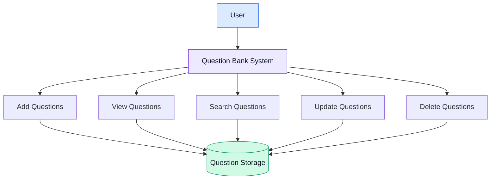

# Question Bank Management System

<div align="center">


### Organize. Manage. Learn.

A simple system for organizing and managing educational questions.


</div>

---

## About the Project

The Question Bank Management System helps users manage educational questions in one organized place.

Users can add, view, update, delete, and search questions easily.

## Key Features

<table>
<tr>
<td width="50%">

### ➕ Add Questions

Create and store new questions.

</td>
<td width="50%">

### 👀 View Questions

Display available questions.

</td>
</tr>

<tr>
<td width="50%">

### ✏️ Update Questions

Edit existing questions.

</td>
<td width="50%">

### 🗑️ Delete Questions

Remove unwanted questions.

</td>
</tr>

<tr>
<td width="50%">

### 🔍 Search Questions

Find questions quickly.

</td>
<td width="50%">

### 📚 Organize Questions

Arrange questions by category.

</td>
</tr>
</table>

---

## System Workflow



---

## Technologies Used

- Programming Language: Add your language
- Database: Add your database
- Development Environment: Add your IDE
- Version Control: Git and GitHub

## Project Structure

```text
Question-Bank-Management-System/
├── assets/
│   └── banner.png
├── README.md
└── project files
```

## Future Improvements

- Automatic exam generation
- Random question selection
- Question categorization
- Difficulty-level filtering
- Import and export questions
- User access management

---

## Team Members

| Name | Role |
|---|---|
| Ahmed Hegazy | Developer |
| Mahmoud Elsayed | Developer |
| Ahmed Adel Monem | Developer |
| Ahmed Abouzied| Developer |
| Eslam Elmasry | Developer |

---

## Project Status

**In Development**

## License

This project is developed for educational purposes.

